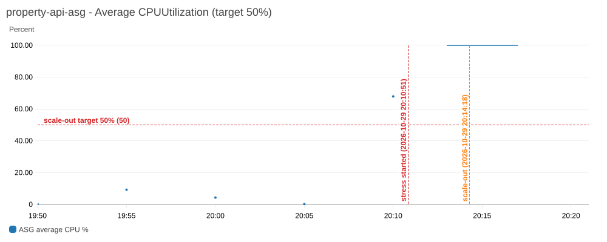
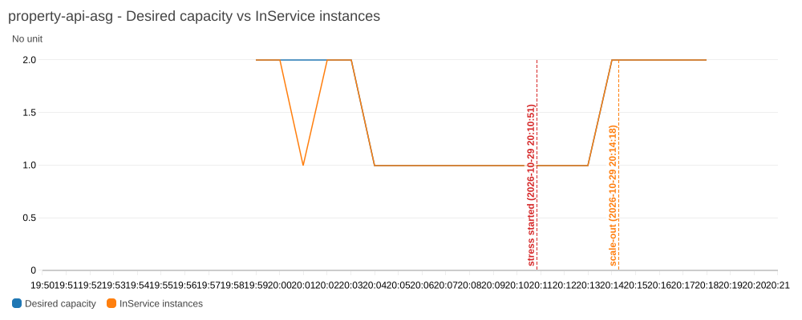
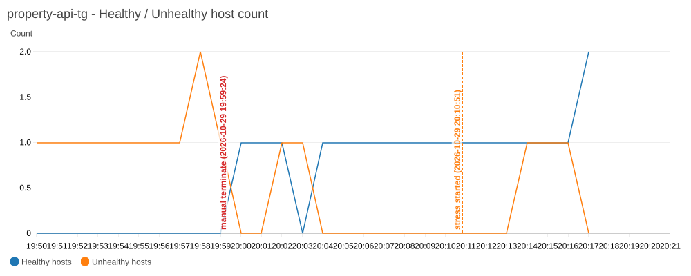

# Week 6 — Load Test Report: ASG behind an ALB

**Date:** 2026-10-29 (all times UTC)
**Region:** us-east-1 · **Account:** 211391213806 · **VPC:** training-vpc (vpc-06057ef2548810af5)
**Built with:** AWS CLI (no console clicks)

## Summary

| Event | Timestamp (UTC) | Gap |
|---|---|---|
| CPU stress started on the only in-service instance (`stress-ng --cpu 2`) | 20:10:51 | — |
| First CloudWatch datapoint above the 50% target (67.9% avg, 100% max) | 20:10:00 minute bucket | — |
| `TargetTracking-…-AlarmHigh` changed OK → ALARM | 20:14:10 | **3 min 19 s** after stress started |
| ASG desired capacity changed 1 → 2, new instance `i-005aca2472d360fe9` launching | 20:14:18 | **3 min 27 s** after stress started |
| New instance healthy in the target group | 20:17:26 | **6 min 35 s** after stress started |

The gap between the CPU spike and the scale-out event was **3 minutes 27 seconds**. The target-tracking policy creates a high alarm that needs 3 consecutive 1-minute datapoints above 50%, so ~3 minutes is the expected floor. (See the note on detailed monitoring below for why it wasn't faster.)

Self-healing was also proven: a manually terminated instance was detected and replaced within **2 minutes**, and the replacement was serving traffic behind the ALB about 5.5 minutes after the kill.

## Screenshots

### 1. CPU spike (ASG average CPUUtilization vs the 50% target)



### 2. Scale-out event (GroupDesiredCapacity and GroupInServiceInstances)



### 3. ALB target health across the self-healing test and the scale-out



Images were rendered from the live CloudWatch metrics with `aws cloudwatch get-metric-widget-image`; vertical markers show when stress started and when the ASG scaled out.

## Lab 6.1 — ASG behind an ALB (what was built)

| Resource | Name / ID | Key settings |
|---|---|---|
| Launch template | `property-api-template` (lt-047d155ecccaba2d9), v6 | AL2023 `ami-041607313c6a2a618`, t3.micro, key `training-key`, SG `property-api-sg-v6`, instance profile `PropertyLite-SSM-Role`, detailed monitoring on, Week 3 user-data |
| Target group | `property-api-tg` | instance type, HTTP:8080, health check `/health`, matcher 200 |
| ALB | `property-api-alb` | internet-facing, public subnets us-east-1a + us-east-1b, listener HTTP:80 → `property-api-tg`, SG `property-alb-sg` (80 from 0.0.0.0/0) |
| ASG | `property-api-asg` | LT `$Latest`, private subnets us-east-1a + us-east-1b, desired/min/max 2/1/4, health check type ELB, grace 300 s |
| Scaling policy | `property-api-cpu-target-tracking` | Target tracking, `ASGAverageCPUUtilization`, target 50 |

Verification through the load balancer:

```
$ curl http://property-api-alb-167577532.us-east-1.elb.amazonaws.com/health
{"status":"ok"}

$ curl http://property-api-alb-167577532.us-east-1.elb.amazonaws.com/properties
[{"LM_Dec_3":"2.0","LM_Int2_3":"1450","L_City":"Sacramento","L_Keyword2":"3","L_ListingID":"R100234","L_Status":"Active","L_SystemPrice":"450000"},
 {"LM_Dec_3":"2.5","LM_Int2_3":"1900","L_City":"Fresno","L_Keyword2":"4","L_ListingID":"R100235","L_Status":"Active","L_SystemPrice":"395000"},
 {"LM_Dec_3":"1.0","LM_Int2_3":"900","L_City":"Sacramento","L_Keyword2":"2","L_ListingID":"R100236","L_Status":"Pending","L_SystemPrice":"299000"}]
```

Same PropertyLite app as Week 3, now served by two instances in private subnets behind the ALB.

### Problem hit on the way: targets stuck "unhealthy"

The ASG was initially pointing at launch template **version 4**, whose user-data began with a literal markdown fence (` ```bash `) pasted in by mistake. cloud-init therefore never ran the script, Flask never started, and every target failed `/health`. Fix: created **version 5** with the clean script (plus `stress-ng` and the SSM instance profile so the stress test could be run without SSH into private subnets), pointed the ASG at `$Latest`, and ran an instance refresh. Both replacement instances passed health checks ~90 seconds after launch.

## Lab 6.2 — Self-healing and scaling

### Self-healing

```
$ aws ec2 terminate-instances --instance-ids i-04cbcc15b43f7e654      # 19:59:24
$ aws autoscaling describe-scaling-activities --auto-scaling-group-name property-api-asg
```

| Time | Activity |
|---|---|
| 19:59:24 | Manually terminated `i-04cbcc15b43f7e654` |
| 20:01:22 | ASG: "instance was taken out of service in response to an EC2 health check indicating it has been terminated" |
| 20:01:24 | ASG: "Launching a new EC2 instance: i-03dec8cb79d6d86a7 … in response to an unhealthy instance needing to be replaced" |
| 20:04:52 | Replacement reported `healthy` by the target group |

Detection-to-launch took **2 minutes**, matching the "~1–2 minutes" expectation.

Side effect worth noting: at 20:03:49 the **AlarmLow** of the same target-tracking policy fired (CPU had been ~0% for 15 minutes) and scaled the group in from 2 → 1. Target tracking keeps desired capacity wherever CPU dictates; a static "desired = 2" does not survive an idle fleet. Setting `min` to 2 would be the way to guarantee two instances.

### Scaling

The instances live in private subnets, so instead of SSH the stress test was pushed through SSM Run Command (AL2023 ships `stress-ng`, the `amazon-linux-extras` / `stress` path in the lab is for AL2):

```
$ aws ssm send-command --targets Key=tag:aws:autoscaling:groupName,Values=property-api-asg \
    --document-name AWS-RunShellScript \
    --parameters 'commands=["nohup stress-ng --cpu 2 --timeout 600 > /var/log/stress.log 2>&1 &"]'
# top on the instance 4 s later: %Cpu(s): 100.0 us
```

CloudWatch `CPUUtilization` for the ASG (period 60 s):

| Minute (UTC) | Average | Maximum |
|---|---|---|
| 20:05 | 0.28% | 0.33% |
| 20:10 | 67.9% | 100% |
| 20:13 | 100% | 100% |
| 20:14 onward | 100% (first instance), new instance warming up | |

Scaling activity:

```
At 2026-10-29T20:14:10Z a monitor alarm TargetTracking-property-api-asg-AlarmHigh-… in state ALARM
triggered policy property-api-cpu-target-tracking changing the desired capacity from 1 to 2.
At 2026-10-29T20:14:16Z an instance was started in response to a difference between desired and
actual capacity, increasing the capacity from 1 to 2.
```

**Note on detailed monitoring.** The launch template originally used basic (5-minute) EC2 monitoring, so CloudWatch only had datapoints at 20:05 and 20:10 for the first few minutes. Target tracking's high alarm evaluates 3 × 60-second periods; with 5-minute data it would have taken ~15 minutes to trip. Detailed monitoring was enabled on the running instance at ~20:13 (`aws ec2 monitor-instances`) and baked into launch template v6, after which the alarm fired within a minute. For any ASG with target tracking, enable detailed monitoring in the launch template.

## Debug Lab 6.3 — ALB returns 502 Bad Gateway

Diagnosis checklist, with what this environment shows:

1. **Target group → Targets tab: healthy or unhealthy?**
   ```
   $ aws elbv2 describe-target-health --target-group-arn …property-api-tg…
   i-03dec8cb79d6d86a7  8080  healthy
   ```
2. **Does the instance SG allow 8080 from the ALB's SG?**
   ```
   property-alb-sg     sg-0e014b8b63a7fabce  80    source 0.0.0.0/0
   property-api-sg-v6  sg-0f76cfe26ea80efeb  8080  source sg-0e014b8b63a7fabce   <-- ALB SG, not "My IP"
   ```
3. **Does `/health` return 200 on the instance directly?**
   ```
   $ curl -i http://localhost:8080/health      (via SSM on the instance)
   HTTP/1.1 200 OK
   {"status":"ok"}
   ```

Root cause in the lab scenario: the instance SG copied from Week 3 only allows 8080 from "My IP", so the ALB's health checks never reach Flask, targets go unhealthy and the ALB has nothing to forward to → 502. Fix: add an inbound rule `TCP 8080, source = <ALB security group ID>` on the instance SG. Here `property-api-sg-v6` was already built that way, so the 502 we actually saw in this lab had a different cause (user-data never started the app — see Lab 6.1), which the same three checks surfaced: unhealthy targets + correct SG + no listener on 8080 pointed straight at the app.

Lesson: an ALB is just another network peer. "Internet-facing" describes who can reach the ALB, not what the ALB is allowed to reach.

## Cleanup

Performed in dependency order, all via CLI:

1. `aws autoscaling delete-auto-scaling-group --auto-scaling-group-name property-api-asg --force-delete` (terminates its instances)
2. `aws elbv2 delete-load-balancer --load-balancer-arn …property-api-alb…`
3. `aws elbv2 delete-target-group --target-group-arn …property-api-tg…`
4. `aws ec2 delete-launch-template --launch-template-name property-api-template`

Result (20:19–20:26 UTC):

```
[20:19:42] 1. delete ASG (force, terminates instances)
[20:25:45]    ASG gone: yes
[20:25:45] 2. delete ALB
[20:25:46]    ALB gone
[20:25:46] 3. delete target group
    deleted
[20:26:08] 4. delete launch template
property-api-template
[20:26:08] verify:
  ASGs: 0  LBs: 0  TGs: 0  LTs: 0
  instances: i-03dec8cb79d6d86a7	terminated i-04cbcc15b43f7e654	terminated i-0241d8df6f7a44526	terminated i-09070d5876351a71b	terminated i-005aca2472d360fe9	terminated 
  TargetTracking alarms left: 0
```

The target-tracking CloudWatch alarms were removed automatically with the scaling policy. Left in place on purpose (not part of this week's cleanup): `training-vpc`, its NAT gateway, the security groups `property-alb-sg` / `property-api-sg-v6`, and the `PropertyLite-SSM-Role` instance profile.
